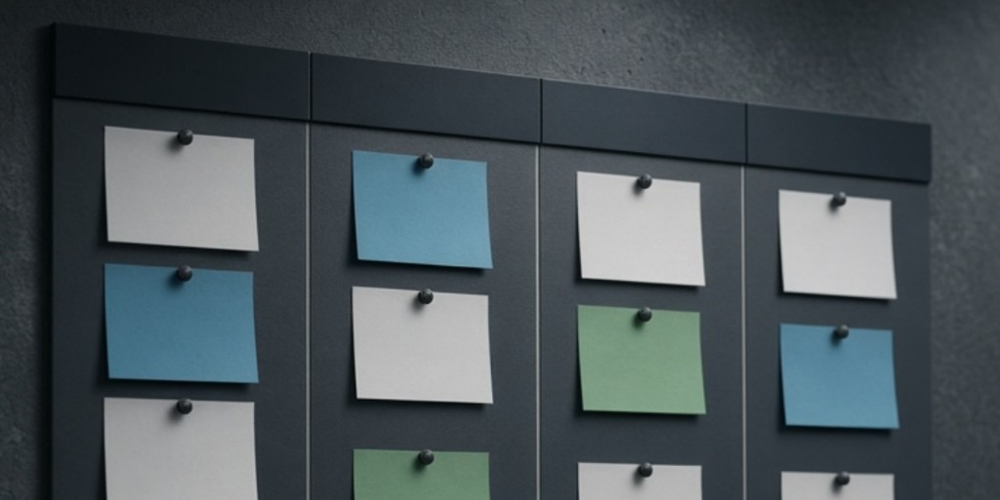

# Boards

A small task board. Create boards, move tasks across four columns, and sign in the same way as AppHub.

Sign in with a local username/password or **Azure AD SAML SSO**. Each board has four columns: Sprint Backlog, In Progress, In Test, and Done. You can rename a column. Port **8093**, HTTPS **443** via Traefik for SAML. Code is in `board/`.



## Run

```bash
cd board
# edit docker-compose.yml with login, Mongo, and SAML values (file is gitignored)
docker compose up -d --build
```

Open http://localhost:8093 or, with Traefik, `https://<host>` (SAML needs HTTPS). Do not commit `docker-compose.yml` or real credentials.

```bash
docker compose down
```

## Config

| Variable | Description |
|----------|-------------|
| `BOARD_USER` / `BOARD_PASSWORD` | Local login |
| `ENABLE_SAML` | `true` = Azure AD SAML button on the login page |
| `SAML_IDENTIFIER` / `SAML_REPLY_URL` | App entity ID and ACS (`/remote/saml/metadata`, `/remote/saml/acs`) |
| `SAML_LOGIN_URL` / `MICROSOFT_ENTRA_IDENTIFIER` / `SAML_CERTIFICATE` | Azure IdP login URL, issuer, and signing cert |
| `FRONTEND_URL_SAML` | Public Boards URL Azure redirects back to |
| `AZURE_APP_ROLE_ADMIN` / `AZURE_APP_ROLE_VIEWER` | Azure app roles. This app uses `BoardAdmin` / `BoardViewer` |
| `ALLOWED_EMAIL_DOMAINS` / `ALLOWED_ORGANIZATIONS_ID` | Optional SAML filters |
| `SESSION_HTTPS_ONLY` | `true` behind Traefik HTTPS. `false` also allows the page on port 8093 |
| `USE_MONGODB` | `true` = MongoDB |
| `MONGO_HOST` | Atlas host (`mongodb.net` shows **mongodb-atlas: Connected**) or a regular MongoDB host (**mongodb: Connected**) |
| `MONGO_DB` | Database name (`board`) |
| `MONGO_URI` | Optional full URI |
| `MONGO_INITDB_ROOT_USERNAME` / `MONGO_INITDB_ROOT_PASSWORD` | Mongo credentials |
| `TZ` | Timezone |

SAML SSO users must be assigned **BoardAdmin** (full access) or **BoardViewer** (read-only) in the Azure Enterprise App. Put the certificate and other secrets only in `docker-compose.yml`.

## What you get

- Local login and Azure AD SAML SSO
- Azure app roles: BoardAdmin / BoardViewer
- Boards you create, with four columns you can rename
- Tasks with a title, a task text, and the time the task was opened
- Drag tasks between columns, edit, clone, and delete
- Dark mode and idle logout after 3 minutes
- MongoDB Atlas. The status line matches AppHub: **mongodb-atlas: Connected** or **mongodb: Connected**

Each board stays one document in the `boards` collection. The same tasks are also copied into a collection per column (`sprint_backlog`, `in_progress`, `in_test`, `done`), the same way AppHub stores each section.

## API

Session cookie after `POST /api/login` or SAML ACS. Main routes: `/api/me`, `/api/boards`. SAML: `/remote/saml/login`, `/remote/saml/acs`, `/remote/saml/metadata`.
